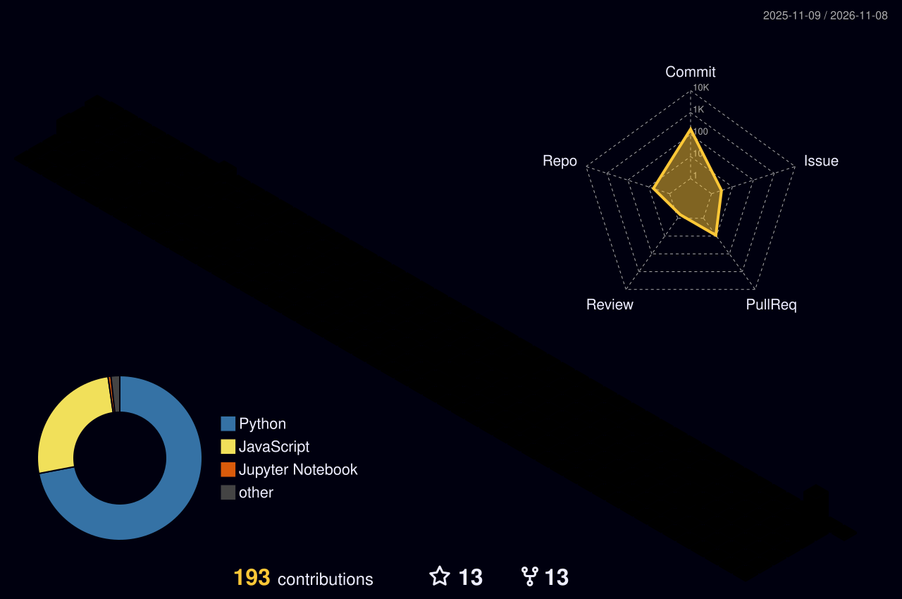

# Hello, I'm Daniel 👋 

🖥️ Computer Scientist | 📍 Bolzano - Verona | [WebSite](https://danielamadori.github.io) | [LinkedIn](https://www.linkedin.com/in/daniel-amadori) | [ORCID](https://orcid.org/0009-0003-4373-7811)

## About Me

- 🎓 **Education:** 
  - Ph.D. in Computer Science (10/2026 – present, XLII cycle, with scholarship) - University of Verona (Topic: formally certified explanations and robustness verification for machine learning classifiers)
  - M.S. in Computer Science and Engineering (Graduated 07/2025, 109/110) - University of Verona (Thesis: Explaining Strategies for Expected Impacts)
  - M.S. (Erasmus) in Intelligent Systems and Numerical Applications in Engineering (9/2023 - 2/2024) - University of Las Palmas de Gran Canaria
  - B.S. in Computer Science (Graduated 12/07/2022, 108/110) - University of Verona (Thesis: A system for contact tracing based on BLE devices)

- 💼 **Work Experience:**
  - (10/2025 – 09/2026) **Post-graduate Research Grant** – University of Verona  
  *Project:* *Impact of time-varying parameters on the dimensional distribution of molecules in chemical processes: modeling and analysis*  
  *Industrial partner:* **NEWCHEM S.p.A.** (Milan, Italy)  
  *Supervisor:* Prof. Pietro Sala  
  *Funding:* Ministry of Enterprises and Made in Italy (Project CB2024MIMIT_NEWCHEM)  
  [📄 Official call (PDF)](https://docs.univr.it/documenti/Concorso/bando/bando412128.pdf)
  - (03/2025 - 06/2025) Tutor of Software Engineering - B.S. in Bioinformatics - University of Verona
  - (03/2025 - 06/2025) Tutor of Software Engineering - B.S. in Computer Science - University of Verona
  - (11/2024 - 02/2025) Tutor of Programming II - B.S. in Computer Science - University of Verona 
  - (11/2024 - 02/2025) Tutor of Programming - B.S. in Bioinformatics - University of Verona
  - (10/2024 - 04/2025) Educator - Integrated digital teaching and digital transition education for school staff
  - (04/2024 - 06/2024) Tutor of Software Engineering - B.S. in Bioinformatics - University of Verona
  - (03/2024 - 06/2024) Tutor of Software Engineering - B.S. in Computer Science - University of Verona
  - (03/2024 - 07/2024) Tutor of Programming with laboratory - B.S. in Applied Mathematics - University of Verona
  - (03/2023 - 06/2023) Tutor of Software Engineering - B.S. in Computer Science, Bioinformatics - University of Verona
  - (10/2022 - 02/2023) Tutor of Programming II - B.S. in Computer Science - University of Verona
  - (09/2021 - 08/2022) High School Teacher - IIS Galileo Galilei - ITT - Computer Science

- 📚 **Publications:**
  - [*Continuous Reasons for Random Forests via Budgeted Ordered Binary Decision Diagrams Compilation*](https://link.springer.com/chapter/10.1007/978-3-032-43514-9_23) - SUM 2026, LNAI vol. 17188, pp. 346-360
  - [*Compiling the Plurality Winner of a Random Forest into OBDDs via Margin Absorption*](https://ceur-ws.org/Vol-4269/paper53.pdf) - ICTCS 2026, CEUR-WS vol. 4269, pp. 288-300
  - [*PACO: A Petri Net-Based Tool for Designing, Simulating, and Analyzing Multi-Objective Stochastic Processes*](https://link.springer.com/chapter/10.1007/978-3-032-27879-1_16) - PETRI NETS 2026, LNCS vol. 16567, pp. 335-346
  - [*DRIFTS: Distributed Robustness for Time Series is Feasible, Distributed, and Fun*](https://ieeexplore.ieee.org/document/11536523) - IEEE CAI 2026
  - [*Time Series Step Tree: A Novel Interpretable Method for Prompt Classification of Time Series*](https://link.springer.com/chapter/10.1007/978-3-032-16469-8_14) - DIS 2025

- :gear: **Git statistics:**

    

